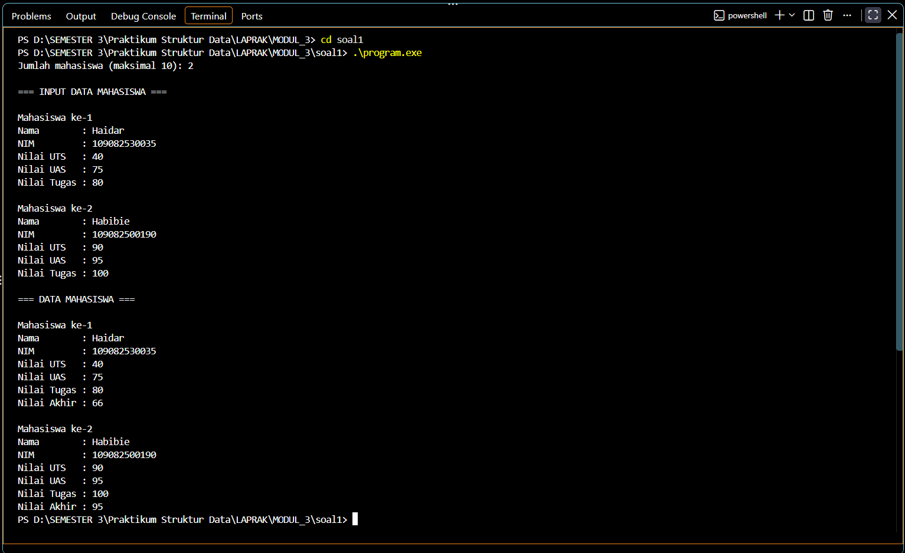
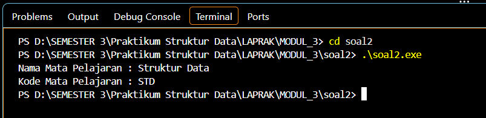
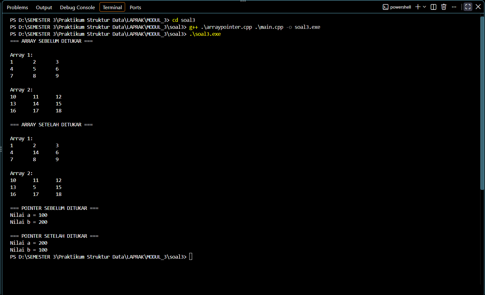

# <h1 align="center">Laporan Praktikum Modul 3 - Abstract Data Type (ADT)</h1>
<p align="center">AHMAD LUTHFI HABIBIE - 109082500190</p>

## Dasar Teori

### A. Abstract Data Type (ADT)<br/>
Abstract Data Type (ADT) adalah TYPE beserta sekumpulan PRIMITIF (operasi dasar) yang berlaku terhadap TYPE tersebut. Pada ADT yang lengkap, disertakan pula definisi invarian dari TYPE dan aksioma yang berlaku, serta ADT merupakan definisi yang bersifat STATIK [1]. ADT mendukung abstraksi, enkapsulasi, dan penyembunyian informasi karena data dan operasi terhadap data tersebut diperlakukan sebagai satu kesatuan [4]. Definisi type dari sebuah ADT juga dapat mengandung ADT lain, misalnya ADT waktu yang terdiri dari ADT JAM dan ADT DATE [1].

#### 1. Primitif pada ADT
Pada konteks prosedural, TYPE diterjemahkan menjadi type yang terdefinisi dalam bahasa pemrograman yang dipakai (pada C/C++ berupa `struct`), sedangkan PRIMITIF diterjemahkan menjadi fungsi atau prosedur. Primitif dikelompokkan menjadi konstruktor/kreator (pembentuk nilai type, biasanya diawali `Make`), selector (mengakses komponen, biasanya diawali `Get`), prosedur pengubah nilai komponen, validator komponen, destruktor/dealokator, baca/tulis (interface dengan perangkat input/output), operator relasional, aritmatika terhadap tipe tersebut, serta konversi dari tipe tersebut ke tipe dasar dan sebaliknya [1].

#### 2. Struktur Berkas Implementasi ADT
ADT biasanya diimplementasikan menjadi dua modul utama dan satu modul *interface* program utama (*driver*). Modul pertama adalah definisi/spesifikasi type dan primitif (header, berkas `.h`) yang berisi spesifikasi type serta prototipe fungsi dan prosedur. Modul kedua adalah *body*/realisasi dari primitif (berkas `.cpp`) yang berisi kode program dari fungsi dan prosedur tersebut. Modul ketiga adalah `main.cpp` sebagai *driver* yang menggunakan ADT tersebut [1]. Pada berkas header umumnya dipakai *include guard* (`#ifndef`, `#define`, `#endif`) agar header tidak terbaca lebih dari satu kali saat proses kompilasi.

#### 3. Fungsi dan Prosedur pada ADT
Fungsi adalah primitif yang mengembalikan sebuah nilai, sedangkan prosedur adalah primitif yang mengubah *state* dari parameter yang diberikan. Pada C++, perubahan nilai pada parameter dilakukan dengan *pass by reference* menggunakan tanda `&`, misalnya `void inputMhs(mahasiswa &m)`, sehingga perubahan pada parameter tersebut ikut mengubah variabel aslinya [1].

### B. Array Dua Dimensi dan Pointer<br/>
Array merupakan salah satu struktur data dasar yang digunakan untuk menyimpan dan mengakses sekumpulan data bertipe sama [3]. Pointer adalah variabel yang menyimpan alamat memori dari variabel lain, dan penggunaannya pada array dua dimensi cukup kompleks karena alamat elemen pada array dua dimensi jumlahnya banyak serta bentuk penulisan pointer untuk mengaksesnya beragam [2].

#### 1. Array Dua Dimensi
Array dua dimensi merupakan array yang elemennya diakses menggunakan dua indeks, yaitu baris dan kolom, dengan bentuk `arr[baris][kolom]`. Pada C++, saat array dua dimensi dikirim sebagai parameter fungsi, ukuran kolomnya harus dituliskan, misalnya `int arr[BARIS][KOLOM]`.

#### 2. Pointer
Pointer dideklarasikan dengan tanda `*`, misalnya `int *p`. Operator `&` digunakan untuk mengambil alamat sebuah variabel, sedangkan operator `*` (*dereference*) digunakan untuk mengakses nilai pada alamat yang ditunjuk pointer [2].

#### 3. Penukaran Nilai (*Swap*)
Penukaran nilai dua variabel dilakukan dengan bantuan variabel sementara (`temp`). Jika penukaran dilakukan melalui pointer, nilai yang tertukar adalah nilai pada variabel asli yang ditunjuk oleh pointer tersebut, bukan hanya salinannya di dalam fungsi.

## Guided 

### 1. mahasiswa.h

```C++
#ifndef MAHASISWA_H_INCLUDED
#define MAHASISWA_H_INCLUDED
struct mahasiswa{
    char nim[10];
    int nilai1, nilai2;
};

void inputMhs (mahasiswa &m) ;
float rata2 (mahasiswa m) ;
#endif //MAHASISWA_H_INCLUDED
```
File `mahasiswa.h` merupakan bagian definisi/spesifikasi type dan primitif. Di dalamnya didefinisikan `struct mahasiswa` yang memiliki tiga field, yaitu `nim` bertipe `char[10]` serta `nilai1` dan `nilai2` bertipe `int`. Setelah itu dideklarasikan prototipe prosedur `inputMhs` yang menerima parameter referensi (`&m`) agar data yang diinput langsung tersimpan pada variabel aslinya, dan fungsi `rata2` yang menerima data mahasiswa lalu mengembalikan nilai rata-rata. Baris `#ifndef`, `#define`, dan `#endif` berfungsi sebagai *include guard* agar header tidak terdefinisi berulang kali.

### 2. mahasiswa.cpp

```C++
#include <iostream>
#include "mahasiswa.h"

using namespace std;

void inputMhs(mahasiswa &m) {
    cout << "input nim ";
    cin >> m.nim;
    cout << "input nilai = ";
    cin >> m.nilai1;
    cout << "input nilai2 = ";
    cin >> m.nilai2;
}

float rata2(mahasiswa m) {
    return float(m.nilai1+m.nilai2)/2;
}
```
File `mahasiswa.cpp` berisi body/realisasi dari primitif yang sudah dideklarasikan pada `mahasiswa.h`. File ini meng-*include* `mahasiswa.h` agar mengenali `struct mahasiswa`. Prosedur `inputMhs` meminta pengguna memasukkan NIM, nilai1, dan nilai2 lalu menyimpannya ke field `m.nim`, `m.nilai1`, dan `m.nilai2`. Fungsi `rata2` menjumlahkan `nilai1` dan `nilai2`, kemudian membaginya dengan 2 dan mengembalikan hasilnya bertipe `float` agar hasil pembagian tidak dibulatkan menjadi bilangan bulat.

### 3. main.cpp

```C++
#include <iostream>
#include "mahasiswa.h"

using namespace std;

int main()
{
    mahasiswa mhs;
    inputMhs (mhs) ;
    cout << "rata-rata = " << rata2 (mhs) ;
    return 0;
}
```
File `main.cpp` berperan sebagai *driver* yang menggunakan ADT `mahasiswa`. Di dalam `main`, dideklarasikan variabel `mhs` bertipe `mahasiswa`, kemudian prosedur `inputMhs` dipanggil untuk mengisi datanya, dan hasil dari fungsi `rata2` ditampilkan ke layar. Dengan pemisahan menjadi tiga file ini, deklarasi type, realisasi primitif, dan program utama menjadi terpisah sehingga program lebih terstruktur dan mudah dikelola.

## Unguided 

### 1. Program penyimpanan data mahasiswa (maksimal 10) ke dalam array dengan field nama, nim, uts, uas, tugas, dan nilai akhir. Nilai akhir diperoleh dari FUNGSI dengan rumus 0.3*uts + 0.4*uas + 0.3*tugas

**mahasiswa.h**
```C++
#ifndef MAHASISWA_H
#define MAHASISWA_H

#include <string>
using namespace std;

struct mahasiswa {
    string nama;
    string nim;
    float uts;
    float uas;
    float tugas;
    float nilaiAkhir;
};

// Prototype fungsi
void  inputmahasiswa(mahasiswa &m);
float hitungNilaiAkhir(mahasiswa m);
void  tampilmahasiswa(mahasiswa m);

#endif
```

**mahasiswa.cpp**
```C++
#include <iostream>
#include <string>
#include "mahasiswa.h"

using namespace std;

float hitungNilaiAkhir(mahasiswa m) {
    return (0.3f * m.uts) +
           (0.4f * m.uas) +
           (0.3f * m.tugas);
}

void inputmahasiswa(mahasiswa &m) {
    cin.ignore();  // bersihkan newline dari input sebelumnya
    cout << "Nama        : ";
    getline(cin, m.nama);
    cout << "NIM         : ";
    cin >> m.nim;
    cout << "Nilai UTS   : ";
    cin >> m.uts;
    cout << "Nilai UAS   : ";
    cin >> m.uas;
    cout << "Nilai Tugas : ";
    cin >> m.tugas;
    m.nilaiAkhir = hitungNilaiAkhir(m);
}

void tampilmahasiswa(mahasiswa m) {
    cout << "Nama        : " << m.nama       << endl;
    cout << "NIM         : " << m.nim        << endl;
    cout << "Nilai UTS   : " << m.uts        << endl;
    cout << "Nilai UAS   : " << m.uas        << endl;
    cout << "Nilai Tugas : " << m.tugas      << endl;
    cout << "Nilai Akhir : " << m.nilaiAkhir << endl;
}
```

**main.cpp**
```C++
#include <iostream>
#include <string>
#include "mahasiswa.h"

using namespace std;

int main() {
    mahasiswa data[10];
    int n;

    cout << "Jumlah mahasiswa (maksimal 10): ";
    cin >> n;

    if (n < 1 || n > 10) {
        cout << "Jumlah mahasiswa harus antara 1 sampai 10." << endl;
        return 0;
    }

    cout << "\n=== INPUT DATA MAHASISWA ===" << endl;

    for (int i = 0; i < n; i++) {
        cout << "\nMahasiswa ke-" << i + 1 << endl;
        inputmahasiswa(data[i]);
    }

    cout << "\n=== DATA MAHASISWA ===" << endl;

    for (int i = 0; i < n; i++) {
        cout << "\nMahasiswa ke-" << i + 1 << endl;
        tampilmahasiswa(data[i]);
    }

    return 0;
}
```
### Output Unguided 1 :

##### Output 1


Program ini menerapkan konsep ADT dengan memisahkan kode menjadi tiga file. Pada `mahasiswa.h` didefinisikan `struct mahasiswa` dengan field `nama`, `nim`, `uts`, `uas`, `tugas`, dan `nilaiAkhir`, beserta prototipe prosedur `inputmahasiswa`, fungsi `hitungNilaiAkhir`, dan prosedur `tampilmahasiswa`. Pada `mahasiswa.cpp`, fungsi `hitungNilaiAkhir` menghitung nilai akhir dengan rumus 0.3*uts + 0.4*uas + 0.3*tugas. Prosedur `inputmahasiswa` membaca seluruh field; `cin.ignore()` dipakai untuk membersihkan karakter *newline* sisa input sebelumnya agar `getline` dapat membaca nama secara utuh, dan di akhir prosedur nilai akhir langsung dihitung serta disimpan ke `m.nilaiAkhir`. Prosedur `tampilmahasiswa` menampilkan seluruh data mahasiswa. Pada `main.cpp`, data disimpan dalam array `data[10]`, jumlah mahasiswa divalidasi harus antara 1 sampai 10, kemudian data diinput dan ditampilkan menggunakan perulangan `for`. Pada contoh output, mahasiswa pertama dengan UTS 40, UAS 75, dan Tugas 80 memperoleh nilai akhir (0.3×40)+(0.4×75)+(0.3×80) = 66, sedangkan mahasiswa kedua dengan UTS 90, UAS 95, dan Tugas 100 memperoleh nilai akhir 95.

### 2. ADT pelajaran pada file "pelajaran.h", implementasi pada "pelajaran.cpp", dan percobaan pada "main.cpp"

**pelajaran.h**
```C++
#ifndef PELAJARAN_H_INCLUDED
#define PELAJARAN_H_INCLUDED

#include <string>
using namespace std;

struct pelajaran {
    string namaMapel;
    string kodeMapel;
};

pelajaran create_pelajaran(string namapel, string kodepel);
void tampil_pelajaran(pelajaran pel);

#endif // PELAJARAN_H_INCLUDED
```

**pelajaran.cpp**
```C++
#include <iostream>
#include "pelajaran.h"

using namespace std;

pelajaran create_pelajaran(string namapel, string kodepel) {
    pelajaran pel;

    pel.namaMapel = namapel;
    pel.kodeMapel = kodepel;

    return pel;
}

void tampil_pelajaran(pelajaran pel) {
    cout << "Nama Mata Pelajaran : " << pel.namaMapel << endl;
    cout << "Kode Mata Pelajaran : " << pel.kodeMapel << endl;
}
```

**main.cpp**
```C++
#include <iostream>
#include "pelajaran.h"

using namespace std;

int main() {
    string namapel = "Struktur Data";
    string kodepel = "STD";

    pelajaran pel = create_pelajaran(namapel, kodepel);

    tampil_pelajaran(pel);

    return 0;
}
```
### Output Unguided 2 :

##### Output 1


Program ini membuat ADT `pelajaran` yang terdiri dari dua field bertipe `string`, yaitu `namaMapel` dan `kodeMapel`, yang dideklarasikan pada `pelajaran.h` beserta dua primitifnya. Fungsi `create_pelajaran` berperan sebagai konstruktor/kreator: fungsi ini menerima nama dan kode mata pelajaran, mengisinya ke variabel `pel`, lalu mengembalikan `pel` sebagai nilai bertipe `pelajaran`. Prosedur `tampil_pelajaran` berperan sebagai primitif tulis yang menampilkan nama dan kode mata pelajaran ke layar. Pada `main.cpp`, data "Struktur Data" dengan kode "STD" dikirim ke `create_pelajaran`, kemudian hasilnya ditampilkan melalui `tampil_pelajaran`. Output yang dihasilkan sesuai dengan contoh pada modul, yaitu nama mata pelajaran "Struktur Data" dan kode mata pelajaran "STD".

### 3. Program dengan 2 array 2D integer berukuran 3x3 dan 2 pointer integer, beserta fungsi/prosedur untuk menampilkan array, menukar isi array pada posisi tertentu, dan menukar isi variabel yang ditunjuk oleh 2 pointer

**arraypointer.h**
```C++
#ifndef ARRAYPOINTER_H_INCLUDED
#define ARRAYPOINTER_H_INCLUDED

const int BARIS = 3;
const int KOLOM = 3;

void tampilArray(int arr[BARIS][KOLOM]);

void tukarArray(int arr1[BARIS][KOLOM],
                int arr2[BARIS][KOLOM],
                int baris,
                int kolom);

void tukarPointer(int *p1, int *p2);

#endif // ARRAYPOINTER_H_INCLUDED
```

**arraypointer.cpp**
```C++
#include <iostream>
#include "arraypointer.h"

using namespace std;

void tampilArray(int arr[BARIS][KOLOM]) {
    for (int i = 0; i < BARIS; i++) {
        for (int j = 0; j < KOLOM; j++) {
            cout << arr[i][j] << "\t";
        }
        cout << endl;
    }
}

void tukarArray(int arr1[BARIS][KOLOM],
                int arr2[BARIS][KOLOM],
                int baris,
                int kolom) {
    int temp;
    temp = arr1[baris][kolom];
    arr1[baris][kolom] = arr2[baris][kolom];
    arr2[baris][kolom] = temp;
}

void tukarPointer(int *p1, int *p2) {
    int temp;
    temp = *p1;
    *p1 = *p2;
    *p2 = temp;
}
```

**main.cpp**
```C++
#include <iostream>
#include "arraypointer.h"

using namespace std;

int main() {
    int array1[BARIS][KOLOM] = {
        {1, 2, 3},
        {4, 5, 6},
        {7, 8, 9}
    };

    int array2[BARIS][KOLOM] = {
        {10, 11, 12},
        {13, 14, 15},
        {16, 17, 18}
    };

    int a = 100;
    int b = 200;
    int *p1 = &a;
    int *p2 = &b;

    cout << "=== ARRAY SEBELUM DITUKAR ===" << endl;
    cout << "\nArray 1:" << endl;
    tampilArray(array1);
    cout << "\nArray 2:" << endl;
    tampilArray(array2);

    tukarArray(array1, array2, 1, 1);

    cout << "\n=== ARRAY SETELAH DITUKAR ===" << endl;
    cout << "\nArray 1:" << endl;
    tampilArray(array1);
    cout << "\nArray 2:" << endl;
    tampilArray(array2);

    cout << "\n=== POINTER SEBELUM DITUKAR ===" << endl;
    cout << "Nilai a = " << a << endl;
    cout << "Nilai b = " << b << endl;

    tukarPointer(p1, p2);

    cout << "\n=== POINTER SETELAH DITUKAR ===" << endl;
    cout << "Nilai a = " << a << endl;
    cout << "Nilai b = " << b << endl;

    return 0;
}
```
### Output Unguided 3 :

##### Output 1


Program ini terdiri dari `arraypointer.h` yang berisi konstanta ukuran array (`BARIS` dan `KOLOM` bernilai 3) serta prototipe tiga primitif, `arraypointer.cpp` yang berisi realisasinya, dan `main.cpp` sebagai driver. Prosedur `tampilArray` menampilkan isi array 2D menggunakan dua perulangan `for` bersarang, dengan `\t` sebagai pemisah antar kolom. Prosedur `tukarArray` menukar isi elemen pada posisi (baris, kolom) tertentu antara dua array dengan bantuan variabel `temp`; pada program ini yang ditukar adalah elemen pada posisi [1][1], sehingga nilai 5 pada `array1` bertukar dengan nilai 14 pada `array2`, sesuai dengan output. Prosedur `tukarPointer` menukar isi dua variabel yang ditunjuk oleh pointer `p1` dan `p2` melalui *dereference* (`*p1` dan `*p2`). Pointer `p1` menunjuk ke variabel `a` (100) dan `p2` menunjuk ke variabel `b` (200), sehingga setelah dipanggil nilai `a` menjadi 200 dan nilai `b` menjadi 100. Hal ini membuktikan bahwa penukaran lewat pointer mengubah nilai variabel aslinya.

## Kesimpulan
Dari praktikum Modul 3 dapat disimpulkan bahwa Abstract Data Type (ADT) adalah cara mendefinisikan sebuah type beserta primitif (operasi dasarnya) dalam satu kesatuan, yang pada C++ diwujudkan dengan `struct` serta fungsi dan prosedur. Penerapan ADT dilakukan dengan memisahkan program menjadi file header (`.h`) untuk spesifikasi type dan prototipe primitif, file body (`.cpp`) untuk realisasi primitif, dan file `main.cpp` sebagai driver, sehingga program lebih terstruktur, mudah dibaca, dan mudah dipakai ulang. Pada latihan pertama dan kedua, ADT `mahasiswa` dan `pelajaran` berhasil diimplementasikan, termasuk penggunaan fungsi untuk menghitung nilai akhir dan fungsi konstruktor `create_pelajaran`. Pada latihan ketiga, penggunaan array dua dimensi dan pointer menunjukkan bahwa nilai dapat ditukar secara langsung pada variabel asli melalui alamat memorinya, baik pada elemen array maupun pada variabel yang ditunjuk pointer.

## Referensi
[1] Laboratorium Informatika, Fakultas Informatika, Telkom University. (t.t.). "Modul 3: Abstract Data Type (ADT)", Modul Praktikum Struktur Data. Bandung: Telkom University.
<br>[2] Bai, W. (2013). "In C Language How to Use Pointer to Access Two-Dimensional Array Element". Proceedings of the 2nd International Symposium on Computer, Communication, Control and Automation (ISCCCA 2013). Atlantis Press. Diakses melalui https://doi.org/10.2991/isccca.2013.18.
<br>[3] Universitas Medan Area. (2025). "Struktur Data dan Algoritma: Pendekatan Visual dan Praktis dalam C++". Medan: PHKI UMA. Diakses melalui https://phki-pghc.uma.ac.id/wp-content/uploads/2025/06/web-8.pdf.
<br>[4] Schmidt, D. C. "C++ Support for Abstract Data Types". Vanderbilt University. Diakses melalui https://ftp.icm.edu.pl/packages/ace/ACE/PDF/c++-adts.pdf.
